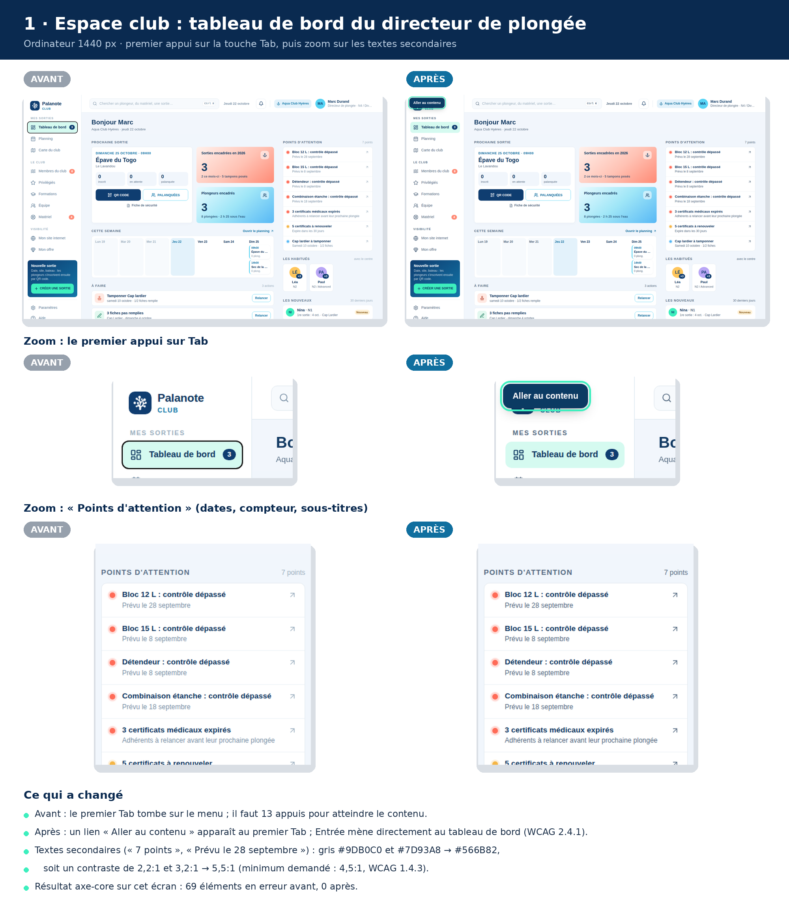
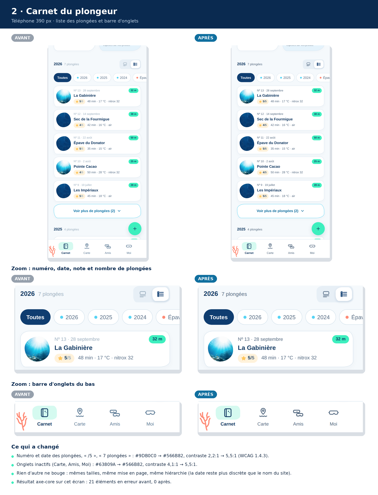
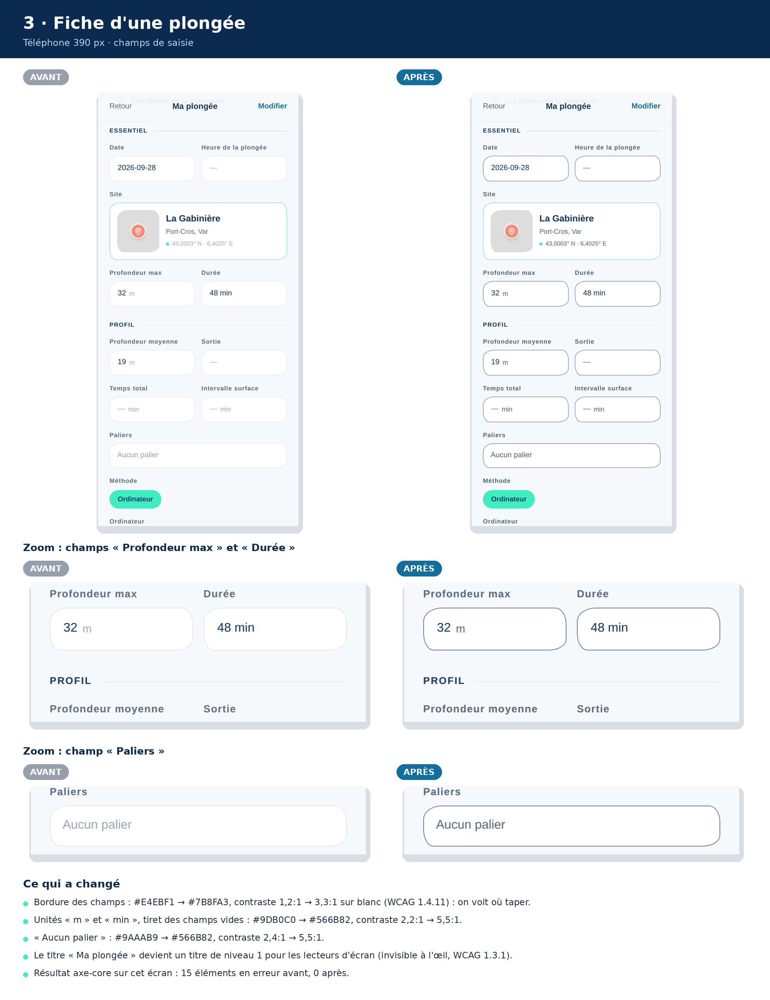

# Audit d'accessibilité WCAG 2.2 — après corrections

**Date :** 22 octobre 2026, même jour que le premier audit (`audit-wcag-2026-10-22.md`)
**Méthode :** la même. axe-core 4.10.2 sur les mêmes 49 écrans, avec les mêmes données, puis les vérifications manuelles (clavier, lien d'évitement, reflow à 320 px). La suite de tests Playwright passe toujours (12 sur 12).

## Résultat

| | Avant | Après |
|---|---:|---:|
| Éléments en erreur (axe-core, WCAG A et AA) | **895** | **18** |
| Écrans sans aucune erreur | 9 sur 49 | **46 sur 49** |
| Erreurs de contraste du texte (1.4.3) | 891 | 17, toutes des faux positifs |
| Champs sans étiquette (4.1.2) | 1 | 0 |
| Cibles trop petites (2.5.8) | 3 | 1, à la limite (voir plus bas) |
| Appuis sur Tab pour passer le menu de l'espace club (2.4.1) | 13 | **1** (« Aller au contenu ») |
| Écrans sans titre de niveau 1 | 2 | 0 |
| Onglets de l'admin avec le même titre de page | 7 | 0 |

**Conclusion :** au regard des tests automatiques et des vérifications manuelles faites, Palanote atteint le niveau AA de WCAG 2.2. Les 18 éléments restants s'expliquent tous, ci-dessous. Ce constat reste à confirmer par un test avec un lecteur d'écran (VoiceOver), car un outil automatique ne voit pas tout.

## Ce qui a été corrigé

1. **Texte secondaire (1.4.3).**
   - Les cinq gris trop pâles (`#9DB0C0`, `#9AAAB9`, `#7D93A8`, `#63809A` et les textes à 55-65 % d'opacité de l'admin) sont remplacés par un seul gris secondaire, **`#566B82`**. Il fait 5,5:1 sur blanc et au moins 4,6:1 sur tous les fonds teintés de l'app.
   - Les autres couleurs de texte un peu justes sur fond teinté sont légèrement foncées :
     - le bleu des liens et pastilles `#1176A8` passe à `#106F9F` ;
     - le vert `#14805F` passe à `#137758` ;
     - les rouges de suppression et d'alerte passent à `#B8432F`.
   - Les placeholders gardent leur gris clair : ce sont des exemples, pas des valeurs.
2. **Corail sur fond clair (1.4.3, 1.4.11).** Le compteur de photos de la plongée express, le bouton « Ajouter une photo » et le tampon de démonstration du site d'un club passent en corail foncé `#C2412D` (5,1:1). La pastille corail « Comptes » de l'admin a désormais un texte bleu nuit.
3. **Bordures des champs (1.4.11).** Les champs de saisie, les listes déroulantes et les champs de recherche ont une bordure `#7B8FA3`, à 3,3:1 sur blanc contre 1,2:1 avant. On voit enfin où taper.
4. **Champs sans étiquette (4.1.2).** La date de fin du certificat médical et le club d'origine (Espace club › Paramètres) ont un nom accessible.
5. **Lien « Aller au contenu » (2.4.1).**
   - Il apparaît au premier appui sur Tab et mène directement au contenu de l'écran.
   - L'espace club et l'admin ont une zone `<main>`.
   - Vérifié : premier Tab sur « Aller au contenu », Entrée, puis le Tab suivant arrive sur la première action de l'écran (la prochaine sortie dans l'espace club, les voyants dans l'admin).
6. **Site d'un club (1.4.3).** Les couleurs du site viennent de la palette choisie par le club. Elles sont maintenant ajustées automatiquement :
   - le texte d'accent sur fond teinté est foncé (ou éclairci sur un site sombre) ;
   - les initiales de l'équipe sont foncées sur une couleur claire et blanches sur une couleur foncée ;
   - le texte secondaire est plus marqué.

   Un club qui choisit des couleurs pâles reste lisible. Dans l'éditeur de l'espace club, l'aperçu du site n'ajoute plus un second `<main>` ni un second titre de niveau 1.
7. **Points mineurs.**
   - **Structure :** un titre de niveau 1 sur « Ma plongée » et « Relecture d'une page ».
   - **Titres de page :** un titre propre à chaque onglet de l'admin (« Palanote — Admin · Agent IA »…), et « Plongée express » au lieu de « Nouvelle plongée ».
   - **Cibles :** pastilles du planning de l'équipe à 24 px de haut, champ des prénoms d'une palanquée à 36 px.
   - **Erreurs de connexion :** le message est relié aux champs (`aria-invalid`, `aria-describedby`).
   - **E-mail annuel :** les gris trop pâles sont aussi corrigés.

## Les 18 éléments restants

| Écran | Nombre | Explication |
|---|---:|---|
| Site d'un club (public) | 4 | **Faux positifs.** La note Google, l'accroche et le bouton « Nous appeler » sont en blanc sur la photo de l'en-tête, assombrie par un voile. axe ne sait pas lire une photo et compare avec la couleur de secours (`#F5F9FB`). À l'écran, le contraste est bon. |
| Espace club › Mon site internet | 13 | **Mêmes faux positifs**, dans l'aperçu du site : le nom du club et le menu sont posés sur la photo de l'en-tête. |
| Espace club › Nouvelle sortie | 1 | Le champ des prénoms d'une palanquée est en partie recouvert par la barre « Créer la sortie » au moment de l'analyse, parce que la page est défilée. En faisant défiler, il se dégage. Le champ lui-même mesure 36 px. |

## Points restés hors corrections

- **Bulles animées (2.2.2).** Elles s'arrêtent quand le téléphone ou l'ordinateur demande moins d'animations, mais il n'y a pas de bouton pause. Comme elles sont décoratives, le risque est faible, et le point est gardé pour plus tard.
- **Lecteur d'écran.** Un test VoiceOver de 10 minutes sur le parcours « numériser une page » reste à faire à la main.

## Comparaison écran par écran

Nombre d'éléments en erreur relevés par axe-core.

| Espace | Écran | Avant | Après | Reste |
|---|---|---:|---:|---|
| Plongeur | Carnet | 21 | 0 | — |
| Plongeur | Fiche plongée | 15 | 0 | — |
| Plongeur | Plongée express | 9 | 0 | — |
| Plongeur | Carte | 3 | 0 | — |
| Plongeur | Numériser | 0 | 0 | — |
| Plongeur | Relecture | 0 | 0 | — |
| Plongeur | Forfait | 2 | 0 | — |
| Plongeur | Espèces | 1 | 0 | — |
| Plongeur | Analyser mes photos | 6 | 0 | — |
| Plongeur | Espèces détectées | 5 | 0 | — |
| Plongeur | Amis | 3 | 0 | — |
| Plongeur | Ajouter un binôme | 0 | 0 | — |
| Plongeur | Moi | 13 | 0 | — |
| Plongeur | Profil | 7 | 0 | — |
| Plongeur | Réglages | 12 | 0 | — |
| Plongeur | Confidentialité (Moi) | 5 | 0 | — |
| Plongeur | Notifications | 0 | 0 | — |
| Plongeur | Récif | 1 | 0 | — |
| Public | Accueil | 0 | 0 | — |
| Public | Connexion | 0 | 0 | — |
| Public | Créer un compte | 0 | 0 | — |
| Public | Mot de passe oublié | 0 | 0 | — |
| Public | Mentions légales | 1 | 0 | — |
| Public | Confidentialité | 1 | 0 | — |
| Public | CGU | 1 | 0 | — |
| Public | Site d'un club | 28 | 4 | faux positifs (texte blanc sur photo) |
| Espace club | Tableau de bord | 69 | 0 | — |
| Espace club | Planning | 33 | 0 | — |
| Espace club | Sortie / palanquées | 78 | 0 | — |
| Espace club | Fiche de sécurité | 26 | 0 | — |
| Espace club | Nouvelle sortie | 24 | 1 | cible en partie masquée par la barre du bas en défilant |
| Espace club | Membres | 129 | 0 | — |
| Espace club | Équipe | 34 | 0 | — |
| Espace club | Matériel | 19 | 0 | — |
| Espace club | Formations | 29 | 0 | — |
| Espace club | Privilégiés | 61 | 0 | — |
| Espace club | Carte du club | 18 | 0 | — |
| Espace club | Site internet | 50 | 13 | faux positifs (texte blanc sur photo) |
| Espace club | Offre | 33 | 0 | — |
| Espace club | Paramètres | 37 | 0 | — |
| Espace club | Notifications club | 46 | 0 | — |
| Admin | Vue d'ensemble | 13 | 0 | — |
| Admin | Agent IA | 9 | 0 | — |
| Admin | Retours | 2 | 0 | — |
| Admin | Erreurs | 7 | 0 | — |
| Admin | Utilisateurs | 7 | 0 | — |
| Admin | Finances | 29 | 0 | — |
| Admin | Lettre annuelle | 8 | 0 | — |
| Espace club | Vitrine (sans centre) | 0 | 0 | — |

## Avant / après en images

Trois écrans, avec un zoom sur ce qui a changé et les contrastes mesurés :

- [Espace club : tableau de bord et lien « Aller au contenu »](captures/01-espace-club-avant-apres.png)
- [Carnet du plongeur : textes secondaires et barre d'onglets](captures/02-carnet-avant-apres.png)
- [Fiche d'une plongée : bordures des champs et unités](captures/03-fiche-plongee-avant-apres.png)

*Résultats bruts : `resultats-axe-apres-corrections-2026-10-22.json`.*
